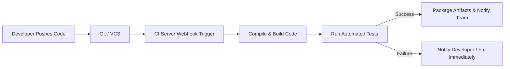

# Continuous Integration (CI) and Jenkins Setup Guide

## 1. What is Continuous Integration (CI)?

**Continuous Integration (CI)** is a software development practice where developers frequently integrate code changes into a shared repository—usually multiple times per day. Every integration is verified by an automated build and automated test suite to detect integration errors as quickly as possible.

### Key Features of CI
* **Frequent Code Integration:** Small, incremental commits pushed to a centralized version control branch (e.g., Git).
* **Automated Builds:** Build triggers automatically upon code commit/merge to compile and package the software.
* **Automated Testing:** Unit tests, integration tests, and linters run immediately to prevent regressions.
* **Immediate Feedback:** Developers receive automated alerts on build and test success/failure.

### Benefits of CI
* **Early Bug Detection:** Catch issues before they reach staging or production environments.
* **Improved Collaboration:** Minimizes "merge hell" and conflicting code changes across team members.
* **Faster Development Cycles:** Automated verification shortens time-to-market.
* **High Code Quality:** Ensures standards and prevents regressions systematically.

---

## 2. CI Workflow



---

## 3. Overview of Popular CI/CD Tools

| Tool | Deployment / Type | Best For | Key Features |
| :--- | :--- | :--- | :--- |
| **Jenkins** | Self-Hosted / Open-Source | Custom workflows, massive plugin ecosystem | 1800+ plugins, distributed Master/Agent nodes, Pipeline as Code |
| **GitHub Actions** | Cloud / Self-Hosted Runner | Repositories hosted on GitHub | Native GitHub integration, YAML workflows, Actions marketplace |
| **GitLab CI/CD** | Cloud & Self-Hosted | GitLab-centric workflows | Native repository integration, Auto DevOps, built-in registry |
| **CircleCI** | Cloud & Self-Hosted | Fast containerized builds | Caching, parallelism, Docker Layer Caching (DLC) |
| **Azure Pipelines** | Cloud & Self-Hosted | Multi-platform & Microsoft stacks | Native integration with Azure and Visual Studio, cross-platform |
| **Travis CI** | Cloud | Open-source and small projects | Simple YAML config, extensive open-source legacy |
| **TeamCity** | Self-Hosted / Cloud | Complex enterprise setups | Powerful build configurations, JetBrains ecosystem integration |
| **Bamboo** | Self-Hosted | Atlassian ecosystem | Native integration with Jira and Bitbucket |
| **Drone** | Container-native | Lightweight containerized pipelines | Docker-based step execution, minimal footprint |
| **Spinnaker** | Multi-Cloud CD | Cloud-native continuous delivery | Advanced deployment strategies (Canary, Blue/Green) |
| **Buildkite** | Hybrid | Scalable enterprise workloads | Secure cloud UI with private/self-hosted runners |

---

## 4. Introduction to Jenkins

**Jenkins** is an open-source automation server enabling developers to reliably build, test, and deploy software.

### Core Concepts
* **Controller (Master) & Agents (Nodes):** Distributed architecture where the controller handles orchestration and agents execute the build workloads.
* **Job / Project:** A configurable automated task or pipeline.
* **Pipeline (`Jenkinsfile`):** A scriptable definition of a CI/CD pipeline, written using Groovy syntax (Declarative or Scripted).
* **Plugins:** Modules that integrate Jenkins with external tools (Git, Docker, Kubernetes, Slack, SonarQube, AWS, etc.).

---

## 5. Jenkins Installation via Docker

### Option A: Quick Run with Docker CLI

To run Jenkins with persistent storage and access to port `8080` (Web UI) and `50000` (Agent communication):

```bash
# 1. Create a persistent volume for Jenkins home
docker volume create jenkins_data

# 2. Run Jenkins LTS container
docker run -d \
  --name jenkins \
  --restart unless-stopped \
  -p 8080:8080 \
  -p 50000:50000 \
  -v jenkins_data:/var/jenkins_home \
  jenkins/jenkins:lts
```

### Option B: Recommended Docker Compose (`docker-compose.yml`)

```yaml
version: '3.8'

services:
  jenkins:
    image: jenkins/jenkins:lts
    container_name: jenkins
    restart: unless-stopped
    ports:
      - "8080:8080"
      - "50000:50000"
    volumes:
      - jenkins_data:/var/jenkins_home
    environment:
      - JAVA_OPTS=-Djenkins.install.runSetupWizard=true

volumes:
  jenkins_data:
```

Start the service:
```bash
docker compose up -d
```

---

## 6. Post-Installation Setup Steps

### Step 1: Retrieve the Initial Admin Password
Execute the following command to retrieve the generated initial password:
```bash
docker exec jenkins cat /var/jenkins_home/secrets/initialAdminPassword
```

### Step 2: Unlock Jenkins
1. Open your browser and navigate to `http://localhost:8080/`.
2. Paste the administrator password copied from the step above.
3. Click **Continue**.

### Step 3: Customize Jenkins
* Select **Install suggested plugins** (recommended for standard Git, Pipeline, and UI features).
* Wait for the plugin installation process to complete.

### Step 4: Create First Admin User
* Fill in:
  * **Username**
  * **Password**
  * **Full name**
  * **E-mail address**
* Click **Save and Continue** (or choose *Skip and continue as admin*).

### Step 5: Instance Configuration
* Confirm the Jenkins root URL (e.g., `http://localhost:8080/` or your domain).
* Click **Save and Finish**, then click **Start using Jenkins**.

---

## 7. Sample Declarative Pipeline (`Jenkinsfile`)

Here is an example of a standard Declarative Pipeline script:

```groovy
pipeline {
    agent any

    stages {
        stage('Checkout') {
            steps {
                echo 'Checking out source code...'
                // git url: 'https://github.com/example/repo.git', branch: 'main'
            }
        }

        stage('Build') {
            steps {
                echo 'Compiling and packaging application...'
                // sh 'mvn clean package' or 'npm run build'
            }
        }

        stage('Test') {
            steps {
                echo 'Running unit and integration tests...'
                // sh 'mvn test' or 'npm test'
            }
        }

        stage('Deploy') {
            steps {
                echo 'Deploying artifact to staging/production...'
            }
        }
    }

    post {
        always {
            echo 'Pipeline run completed.'
        }
        success {
            echo 'Build and test succeeded!'
        }
        failure {
            echo 'Pipeline failed. Check logs for details.'
        }
    }
}
```
